# ☠️ skeleto-nn

Neural network powered character motion for **any skeleton**: people, 🐕 🐈‍⬛ 🐎 🦅 🐍

A body is a tree of bones with joint limits, masses and a few anatomical and physiological numbers; what it does is
decided by small networks that are trained, without motion capture, against the physical and physiological
consequences of what they do (injury, pain, strain, energy, fatigue, falls, heat loss, blood loss, wind).

| network | what it decides | inputs | weights | state |
|---|---|---|---|---|
| **Style network** (`adapt/`, [docs/ADAPT.md](docs/ADAPT.md)) | how a body moves in its situation: stride, crouch, lean, arms out or hugged, a hand on a wound, limp, shiver, wingbeat | body, 24 situation channels (friction, sinking feet, wetness, cold, wind, darkness, smoke, blood loss, pain per region, fatigue, load ...) | [`results/style_net.json`](results/style_net.json), MLP 31-64-64-24, about 7,800 weights | works: 99.9 % of a per-case optimisation; trained in about 25 s on a CPU |
| **Jump network** (`adapt/leap.py`, [docs/ADAPT.md](docs/ADAPT.md#jumping-by-context-adaptleappy)) | whether and how to jump: hop, vault with the hands, pull up onto a ledge, drop, jump into water, or refuse | the ground ahead as a profile (height and water depth every quarter leg length), body, the same 24 channels | [`results/leap_net.json`](results/leap_net.json), MLP scored per landing place, about 14,000 weights | works: 91 % of a per-case optimisation, 95 % the same jump-or-stay decision |
| **Motor networks**, one per body family (`motor/`, [docs/MOTOR.md](docs/MOTOR.md)) | every joint, 30 times a second | body, environment, goal, the body's state, a motivation profile | none yet | in progress: the evaluation system, the environments and the trainer work; the biped walks and runs at about the asked speed, the dog and cat walk; birds do not fly yet (see below) |

The style and jump networks are trained on differentiable consequence models (fast and exact, but reduced-order);
the motor networks are trained by reinforcement learning in MuJoCo. Their forward passes are a few lines of code in
any language; a GDScript port runs both finished networks in the Reval Rebel game.

## Showcase

### Style network: one network for ground, weather, injury and state

The network sets the style; the bodies are drawn by the kinematic baseline walker of this repository (see
[Baselines](#baselines-code-that-is-not-a-network)).

<table>
<tr><td width="50%" valign="top">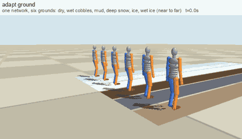<br><b>adapt_ground</b><br>dry, wet cobbles, mud, deep snow, ice, wet ice</td><td width="50%" valign="top">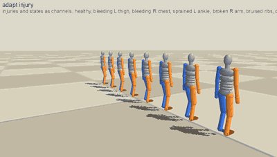<br><b>adapt_injury</b><br>bleeding thigh and chest, sprain, broken arm, bruised ribs, drunk, exhausted</td></tr>
<tr><td width="50%" valign="top">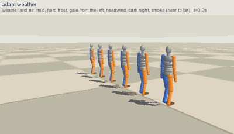<br><b>adapt_weather</b><br>frost, gale from the side, headwind, night, smoke</td><td width="50%" valign="top">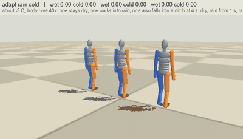<br><b>adapt_rain_cold</b><br>rain soaks the body, the core cools, the network answers (body time 40x)</td></tr>
<tr><td width="50%" valign="top">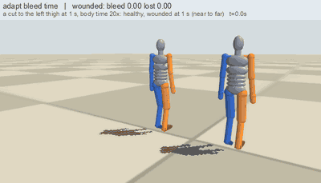<br><b>adapt_bleed_time</b><br>a cut at 1 s: hand to the wound, blood lost grows (body time 20x)</td><td width="50%" valign="top">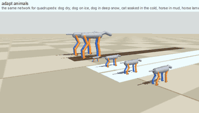<br><b>adapt_animals</b><br>dog on ice and in snow, soaked cat, horse in mud, lame horse</td></tr>
<tr><td width="50%" valign="top">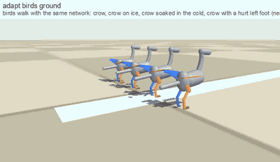<br><b>adapt_birds_ground</b><br>crow on ice (wings out), soaked, hurt foot</td><td width="50%" valign="top">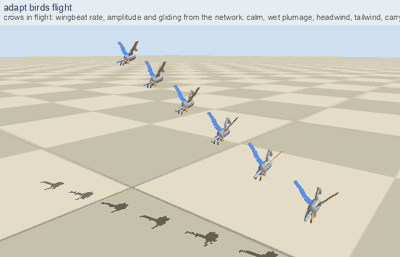<br><b>adapt_birds_flight</b><br>calm, wet plumage, headwind, tailwind, carrying prey, hurt wing</td></tr>
<tr><td width="50%" valign="top">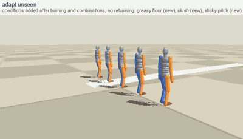<br><b>adapt_unseen</b><br>conditions written after training, and combinations</td><td></td></tr>
</table>

### Jump network: what a 58 kg teenager does in front of ...

`python -m adapt.leap --probe` (each cell is the network's choice; the full table is in
[docs/ADAPT.md](docs/ADAPT.md#jumping-by-context-adaptleappy)):

| ahead | normal | ice | sprained ankle | heavy load |
|---|---|---|---|---|
| wall 0.85 m | vault, hands on the top | refuse | refuse | refuse |
| wall 1.3 m | vault | refuse | refuse | refuse |
| ledge 1.4 m | pull up | refuse | pull up | refuse |
| drop 1 m | drop, knees give | refuse | drop | drop |
| drop 2.5 m or 6 m onto stone | refuse | refuse | refuse | refuse |
| quay over deep water, summer | jump in | refuse | jump in | refuse |
| cliff over shallow water | refuse | refuse | refuse | refuse |

### Motor networks: the biped training runs

Reinforcement learning without reference motion finds cheap but wrong answers first. Runs 1 to 3 found three of
them; runs 4 and 5 walk on their own ([docs/MOTOR.md](docs/MOTOR.md) has the details and the fixes). Run 5,
no harness, no clips, every joint from the network:

<table>
<tr><td width="33%" valign="top">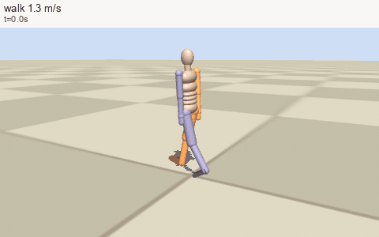<br><b>walk</b>, asked for 1.3 m/s: 1.36 m/s for the full 10 s</td>
<td width="33%" valign="top">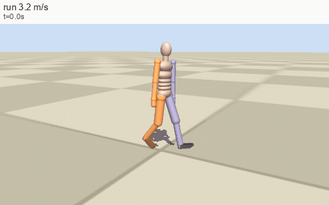<br><b>run</b>, asked for 3.2 m/s: 2.87 m/s</td>
<td width="33%" valign="top">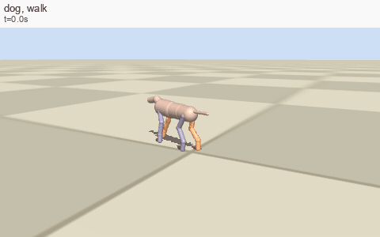<br><b>dog walk</b>: 1.0 m/s for the full 10 s (head carried low)</td></tr>
</table>

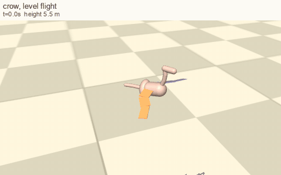<br><b>crow, first flapping flight</b> (run 6, no
harness, height in the caption): asked to fly level at 2.8 units (about 8.5 m/s), it loses about 1.5 m in the first
2 s, then beats its wings and climbs slowly (3.8 m to 6.5 m by 10 s). Every joint, the wingbeat included, is the
network's. The neck held straight up is not penalised yet; side wind, gull and heron still fall.

The same biped network also walks on ice, with a sprained ankle, in a gale, as a child and as an elder; it still
falls when turning from a walk and under a 20 kg pack. The quadruped network walks as a dog, a lame dog and a cat;
the horse, the pig and a dog on ice still fall. Earlier runs, for the record:

<table>
<tr><td width="33%" valign="top">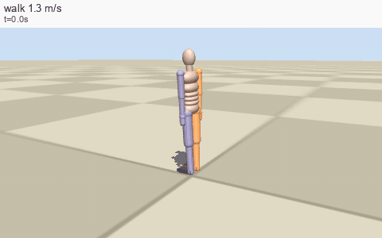<br><b>run 1</b>, asked to walk at 1.3 m/s, harness at 40 %: the harness pushed toward the goal, so the policy learned to lean stiffly and be pushed; it falls like a plank</td>
<td width="33%" valign="top">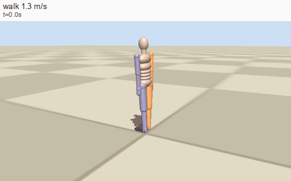<br><b>run 2</b>, same request, full harness: with a reward for staying up and a harness that only holds, it learned to stand still (0.04 m/s)</td>
<td width="33%" valign="top">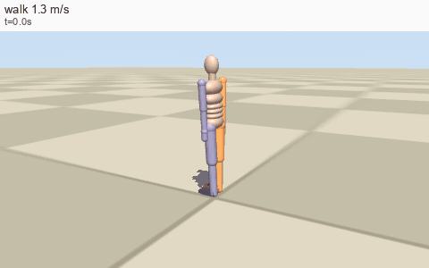<br><b>run 2</b> without the harness: it falls within 2 s</td></tr>
</table>

<!-- motor-status:start -->
### Current state (updated automatically by `python -m motor.showcase`)

The best network of each family so far, no harness, no clips: every joint from the network. The score is the population test mean (survival share x (0.3 + goal), at most 1.3).

**People**: score 1.06 after 71 rounds (updated 2026-10-17 14:05)

<table><tr>
<td width="20%" valign="top">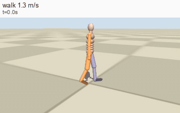<br><b>walk 1.3 m/s</b>: held 8.0 s, 1.34 m/s, goal 0.92</td>
<td width="20%" valign="top">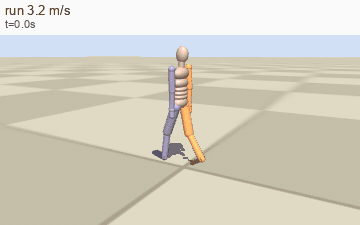<br><b>run 3.2 m/s</b>: held 8.0 s, 2.85 m/s, goal 0.81</td>
<td width="20%" valign="top">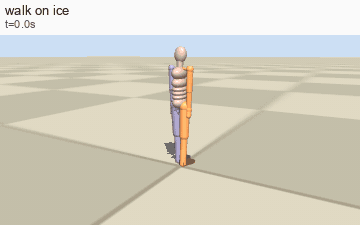<br><b>walk on ice</b>: fell at 1.9 s, 0.52 m/s, goal 0.12</td>
<td width="20%" valign="top">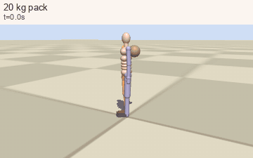<br><b>20 kg pack</b>: held 8.0 s, 1.20 m/s, goal 0.73</td>
<td width="20%" valign="top">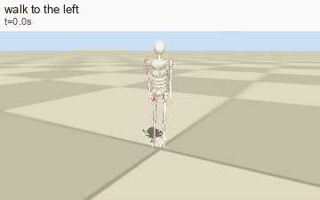<br><b>walk to the left</b>: held 8.0 s, 1.22 m/s, goal 0.91</td>
</tr></table>

**Four-legged animals**: score 0.73 after 71 rounds (updated 2026-10-17 14:05)

<table><tr>
<td width="25%" valign="top">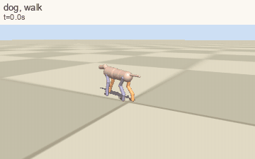<br><b>dog, walk</b>: held 8.0 s, 1.21 m/s, goal 0.92</td>
<td width="25%" valign="top">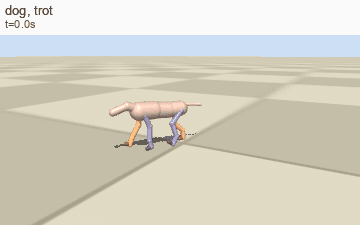<br><b>dog, trot</b>: held 8.0 s, 1.57 m/s, goal 0.57</td>
<td width="25%" valign="top">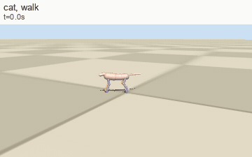<br><b>cat, walk</b>: held 8.0 s, 0.67 m/s, goal 0.80</td>
<td width="25%" valign="top">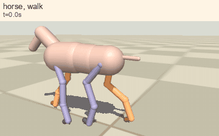<br><b>horse, walk</b>: fell at 3.2 s, 0.29 m/s, goal 0.13</td>
</tr></table>

**Birds**: score 0.99 after 22 rounds (updated 2026-10-17 14:06)

<table><tr>
<td width="25%" valign="top">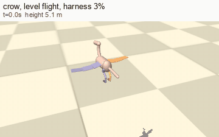<br><b>crow, level flight</b>: held 8.0 s, height 5.4 → 4.2 m, 8.7 m/s, goal 0.78</td>
<td width="25%" valign="top">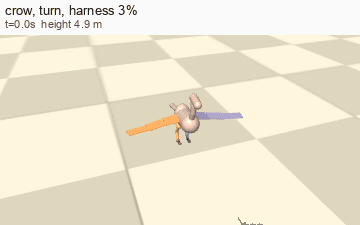<br><b>crow, turn</b>: held 8.0 s, height 5.5 → 4.5 m, 8.8 m/s, goal 0.80</td>
<td width="25%" valign="top">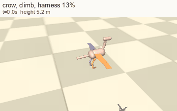<br><b>crow, climb</b>: fell at 4.4 s, height 3.2 → 0.1 m, 7.4 m/s, goal 0.24</td>
<td width="25%" valign="top">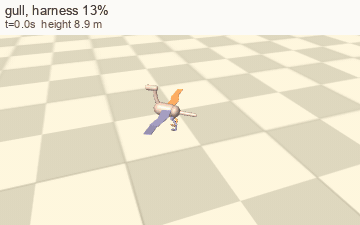<br><b>gull</b>: held 8.0 s, height 9.2 → 1.2 m, 8.2 m/s, goal 0.31</td>
</tr></table>

<!-- motor-status:end -->

## Status

| part | state |
|---|---|
| Style network for people, quadrupeds and birds | works; 99.9 % of per-case optimum on held-out cases; tests |
| Jump network for people and quadrupeds | works; 91 % of per-case optimum, 95 % same decision; numpy equals torch; tests |
| Motor networks: evaluation system (`motor/evaluate.py`) | works; each term responds to its own consequence (tests) |
| Motor networks: shared family environment with muscle activation (`motor/family.py`), biped, quadruped and bird families (`motor/biped.py`, `motor/quadruped.py`: dog, cat, wolf, goat, horse, pig, bear on one canonical skeleton; `motor/bird.py`: flight for crow, gull, heron, sparrow, duck), mirror symmetry, PPO with symmetry loss, curriculum and fading harness (`motor/ppo.py`), population-based training where bad runs die off (`motor/pbt.py`) | works; tests |
| Motor networks: a biped or quadruped policy that walks | biped (run 5, above): walks and runs at the asked speed on flat ground, on ice, hurt, in wind, as a child or an elder; turns from a walk and a heavy pack still fall. Quadruped: dog, lame dog and cat walk; horse, pig and ice fall. Training continues |
| Bird motor network | the crow flies by flapping, on its own, for 15 s (run 6, above); it climbs slowly when asked to hold height; side wind, gull and heron still fall; the sparrow waits for a faster control rate |
| Mixed-body (monkey, bear on two legs, kangaroo, penguin) and snake motor networks | not started |
| A distilled pose network that a game runs without physics | not started |

## Run it

```bash
python3.11 -m venv .venv && source .venv/bin/activate
pip install -r requirements.txt
export MUJOCO_GL=glfw                           # macOS; on Linux use egl or osmesa

python -m adapt.train                           # style network (about 25 s, CPU); --init FILE --steps 800 to warm start
python -m adapt.train --check                   # against per-case optimal styles on held-out cases
python -m adapt.probe --body dog                # what the network does in named situations
python -m adapt.leap                            # jump network (about 12 min, CPU); --check, --probe
python -m adapt.export_engine OUT_DIR           # weights, condition registry and golden vectors for ports

python -m motor.pbt --family biped --name biped_pbt --members 3 --workers 3   # population training (also --family quadruped)
python -m motor.ppo --family biped --name biped --workers 15 --hours 4   # a single run
python -m motor.show runs/motor/biped/ckpt.pt [out_dir] [--assist 0.4]   # GIFs and summary.json, ten review situations

python -m pytest tests/test_adapt.py tests/test_leap.py tests/test_motor.py
```

Needs ffmpeg for GIFs. Python 3.10+.

## Using the networks in an engine

`python -m adapt.export_engine OUT_DIR` writes `style_net.json` and `leap_net.json` (weights with their input and
output schema), the condition registry, and golden vectors (inputs with the expected outputs) so that a port can be
checked number for number. A port is a matrix multiply, a tanh and a sigmoid per layer; see `adapt/net.py` for the
numpy version. The motor networks will be exported the same way once a policy works, as a distilled pose network
that needs no physics engine.

## Baselines: code that is not a network

The repository started as a workbench of other methods, and their code is kept as baselines to compare the motor
networks against, and as the presentation layer of the style network's GIFs. They are no longer documented or
showcased, and they will be deleted family by family as the motor networks replace them:

| module | method |
|---|---|
| `planner.py`, `terrain.py`, `nav.py`, `controls.py`, `jumper.py`, `climb.py`, `aids.py` | kinematic walker: gait from the Froude number, footholds, a jump self-model |
| `goals.py`, `posing.py`, `skills.py`, `catalog_hang.py` | authored goal sequences solved by IK (chair, ladder, door) |
| `catalog_home.py` (swim strokes), `catalog_birds.py` (flapping, landing), `catalog_extra.py` (snake) | hand-built phase models |
| `reflex.py`, `slide.py`, `swimmer.py`, `flier.py`, `swim_evolve.py`, `flier_evolve.py`, `results/reflex_*.json`, `results/slide_controller.json`, `results/swim_*.json`, `results/bird_*.json` | controller parameters evolved by CMA-ES |
| `env.py`, `train.py`, `eval_policy.py`, `ref.py` | PPO tracking the walker's reference (never converged) |
| `hit.py`, `combat.py`, `catalog*.py`, `shots.py`, `bake_clip.py`, `export_clip.py`, `make_showcase.py`, `phys_gifs.py` | reactions, scenes, clip baking, the old showcase |

Shared by everything and kept: `skeleton.py` and `bodies.py` (bones, parametric bodies), `physics.py`, `water.py`,
`air.py` (MuJoCo bodies with water and air), `injury.py` (the bone-injury model the evaluation system uses),
`render.py` (GIF rendering).

## Layout

| path | role |
|---|---|
| `adapt/` | style network and jump network: schema, conditions, consequence models, training, physiology, export ([docs/ADAPT.md](docs/ADAPT.md)) |
| `motor/` | motor networks: evaluation system, body-family environments, PPO, review renderer ([docs/MOTOR.md](docs/MOTOR.md)) |
| `results/` | trained weights (`style_net.json`, `leap_net.json`) and baseline parameter files |
| `showcase/` | GIFs of the style network (`adapt/`) and of the motor training runs (`motor/`) |
| `tests/` | tests |

## License

MIT, see `LICENSE`.
